# Deploying a LAMP Stack on Azure using Ubuntu Server

Comprehensive infrastructure configuration detailing the deployment of a LAMP stack (Linux, Apache, MySQL, PHP 8.3) on an Azure Ubuntu Server 24.04 LTS virtual machine, including web server setup, database securing, and PHP environment validation.

---

## 1. Architecture & Provisioned Resources

### Core Infrastructure Topology

| Resource Type | Resource Name | Specification / Tier | Region / Location |
| :--- | :--- | :--- | :--- |
| **Virtual Machine** | `MyLAMPVM` | Standard_B2s, Ubuntu 24.04 LTS (x64 Gen2) | East US |
| **Virtual Network** | `vnet-eastus-1` | `172.16.0.0/16` (`snet-eastus-1`: `172.16.0.0/24`) | East US |
| **Public IP Address** | `MyLAMPVM-ip` | Static Standard IPv4 (`20.102.70.179`) | East US |
| **Network Security Group** | `MyLAMPVM-nsg` | Inbound Rules: HTTP (80), HTTPS (443), SSH (22) | East US |
| **Network Interface** | `mylampvm655` | Dynamic Private IP (`172.16.0.4`) | East US |
| **OS Disk** | `MyLAMPVM_OsDisk_1...` | 30 GB, Standard SSD LRS | East US |

---

### Provisioned Environment Validation

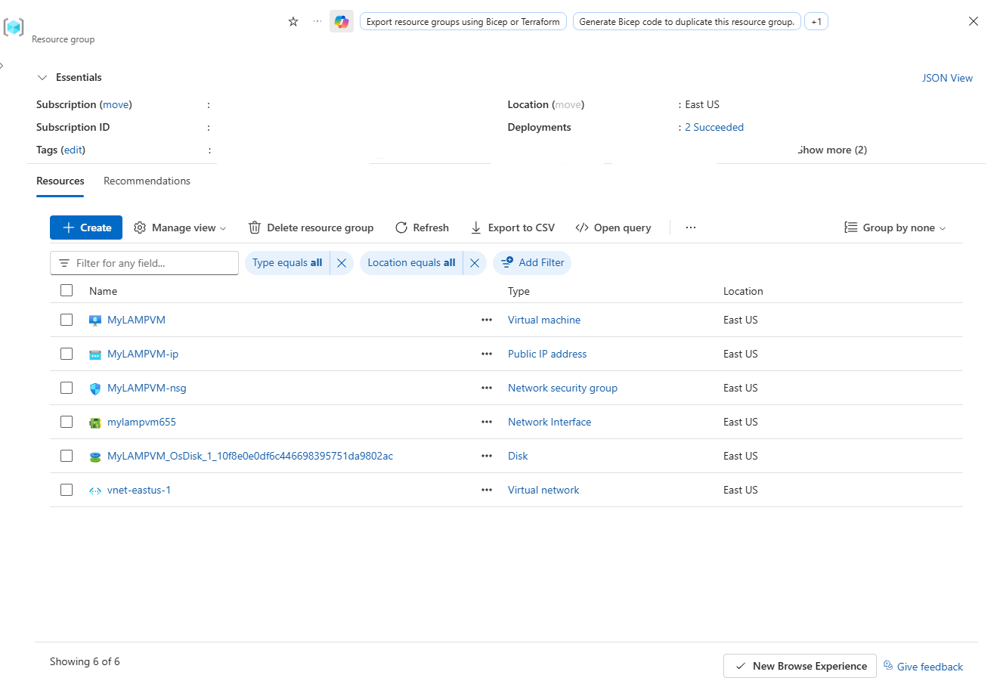

*Resource group overview confirming successful provisioning of the virtual machine, public IP address, network security group, network interface, OS disk, and virtual network.*

---

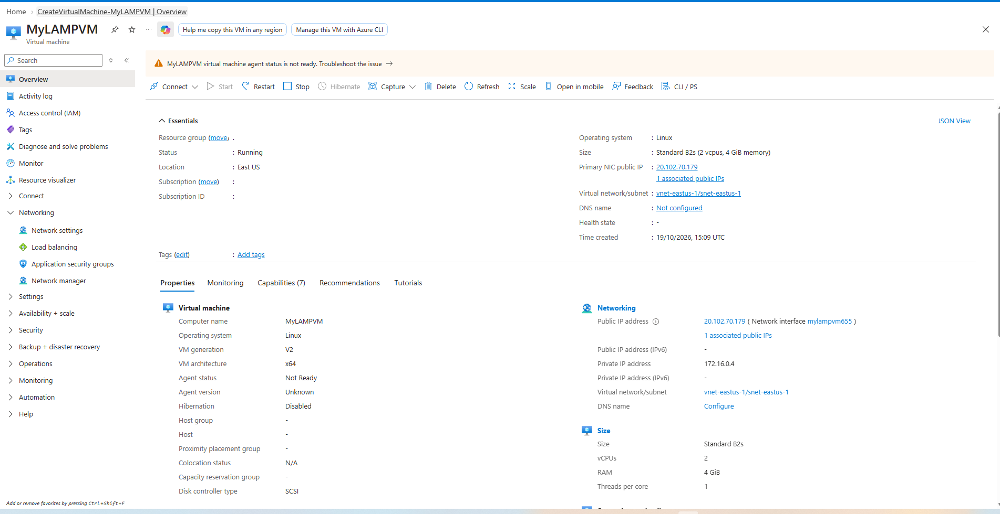

*Virtual machine overview pane showing MyLAMPVM running Ubuntu Linux on Standard_B2s size with associated public IP.*

---

## 2. Step-by-Step Implementation

### Step 1: Update Advanced Package Tool (APT) Repositories

Connected via SSH to `MyLAMPVM` and refreshed the package index to retrieve information on the latest package versions.

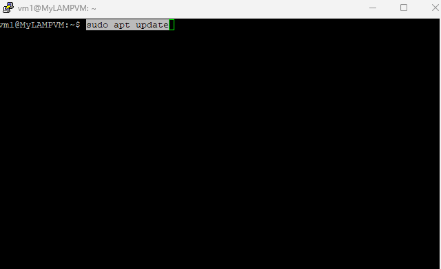

*Executing apt update command to fetch updated package lists.*

---

### Step 2: Upgrade Operating System Packages

Upgraded all installed system packages to their latest versions to ensure system stability and security patch coverage.

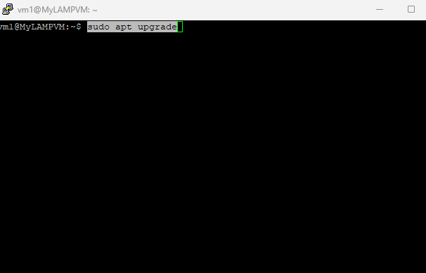

*Running apt upgrade command to apply OS package updates.*

---

### Step 3: Install Apache2 Web Server

Installed the Apache HTTP server package using the package manager.

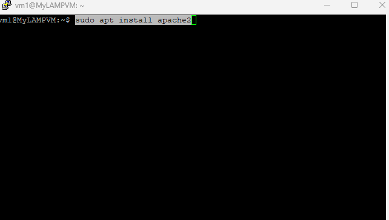

*Installing Apache2 web server on the Ubuntu instance.*

---

### Step 4: Validate Apache Web Server Operation

Navigated to the public IP address (`20.102.70.179`) in a web browser to verify default page delivery over port 80.

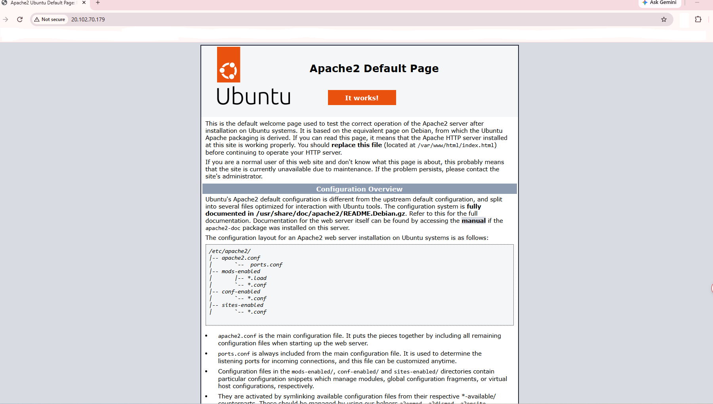

*Successful HTTP request validation confirming the operation of Apache2 Default Page.*

---

### Step 5: Install MySQL Relational Database Management System

Installed MySQL Server to provide database services for the LAMP stack.

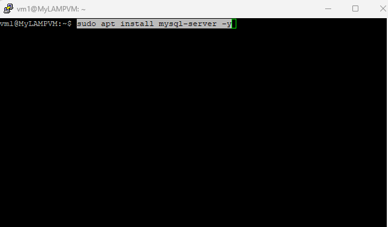

*Deploying MySQL Server database engine.*

---

### Step 6: Secure MySQL Installation

Ran the security script to configure root password security, remove anonymous accounts, and disallow remote root login.

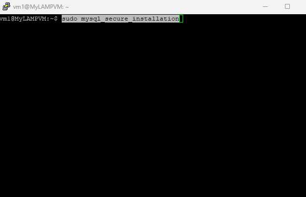

*Executing mysql_secure_installation script to apply security hardening.*

---

### Step 7: Install PHP and Web Server Integration Modules

Installed PHP 8.3 along with the Apache module (`libapache2-mod-php`) and MySQL database driver (`php-mysql`).

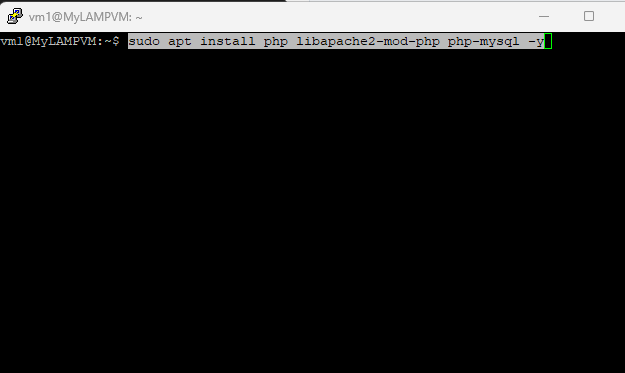

*Installing PHP interpreter and required Apache and MySQL integration libraries.*

---

### Step 8: Create PHP Test Page

Generated an `info.php` script inside the web root directory `/var/www/html/` to display system and configuration details.

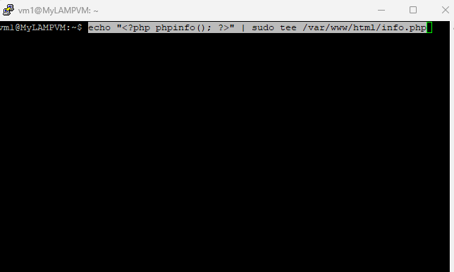

*Writing PHP info script to the default document root.*

---

### Step 9: Verify PHP Configuration and Processing

Accessed `http://20.102.70.179/info.php` in the browser to confirm that Apache correctly processes PHP scripts and renders module outputs.

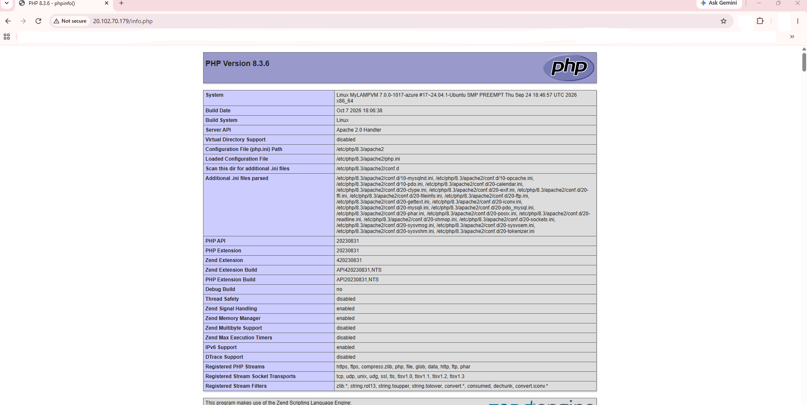

*Successful rendering of PHP Version 8.3.6 configuration page confirming complete LAMP stack deployment.*
